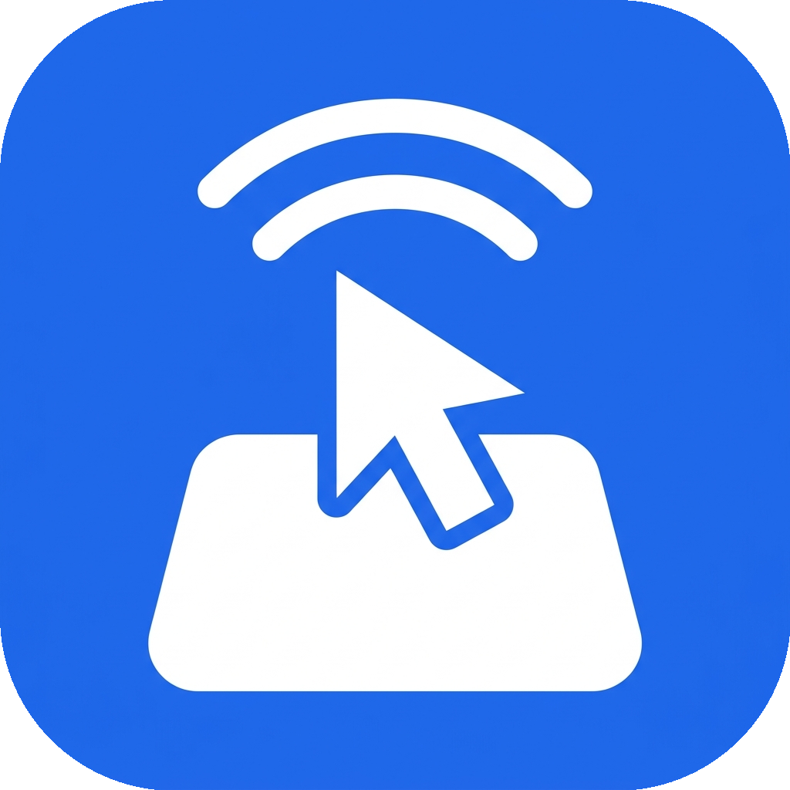

# AirTouch PC

<div align="center">



### Seamless Wireless Trackpad, Keyboard & Presentation Remote for Windows

[](#)
[](#)
[](#)
[](LICENSE)
[](https://github.com/anesdevv/AirTouch-PC/releases/latest)

</div>

---

## ⚡ Direct Downloads

| Client | Platform | Distribution | Status | Download |
| :--- | :--- | :--- | :--- | :--- |
| **AirTouch PC** | Windows (x86 / x64 / ARM64) | Single Portable `.exe` | **v1.0.0 Ready** | [📥 **Download AirTouchPC.exe**](https://github.com/anesdevv/AirTouch-PC/releases/latest/download/AirTouchPC.exe) |
| **AirTouch Mobile** | Android 7.0+ | Standalone `.apk` | **v1.0.0 Ready** | [📥 **Download AirTouch.apk**](https://github.com/anesdevv/AirTouch-PC/releases/latest/download/AirTouch.apk) |

> **Zero Installation Required**: AirTouch PC targets the built-in Microsoft .NET Framework (4.0 / 4.8) already included in all standard installations of Windows 10, Windows 11, 8, and 7. No installers, no Python runtimes, no dependencies. Just download and run.

---

## ✨ Features

- **⚡ Zero-Install & Truly Portable**: A single, self-contained `AirTouchPC.exe` with zero external dependencies or setup scripts.
- **📱 Instant Pairing with QR Code**: Automatically detects active network interfaces (Wi-Fi, Ethernet, LAN) and generates an offline, high-contrast QR code token for instant camera pairing.
- **🏎️ Ultra-Low Latency Protocol**:
  - **UDP (`Port 54545`)**: High-frequency, jitter-free cursor tracking and bi-directional mouse wheel scrolling.
  - **TCP (`Port 54546`)**: High-reliability protocol for clicks, Unicode text input, shortcut chords, and ping/pong keepalive.
- **📊 Real-Time Hardware Signal Bar**: Discrete tactile pulse indicators (`Touch`, `Click`, `Scroll`, `Keys`, `Laser`) that light up and softly fade upon receiving input, providing immediate visual feedback without terminal clutter.
- **🔄 Adaptive Session State**: Standby pairing view automatically transitions to an **Active Remote Session Dashboard** (showing session duration, total inputs processed, remote endpoint, and a one-click disconnect button).
- **🔕 System Tray Integration**: Minimizes cleanly to the Windows taskbar notification area to stay out of your way while gaming, presenting, or coding.
- **🛡️ 1-Click Firewall Configuration**: Built-in detection and one-click administrator rule configuration for the Windows Advanced Firewall.
- **🖥️ Per-Monitor DPI Aware**: Crisp, pixel-perfect rendering across high-DPI laptop displays and multi-monitor setups.

---

## 🚀 Quick Start Guide


1. **Launch PC Companion**:
   Download and run [AirTouchPC.exe](https://github.com/anesdevv/AirTouch-PC/releases/latest/download/AirTouchPC.exe).
2. **Open Mobile App**:
   Launch the AirTouch app on your Android device (ensure both devices are connected to the same Wi-Fi or local network).
3. **Scan to Pair**:
   Point your phone's camera at the QR code displayed on your screen (or tap **Copy Pairing Link** to paste it manually).
4. **Enjoy Seamless Remote Control**:
   Use your phone screen as a trackpad, type with your phone keyboard, or control slides during presentations.

---

## 🛠️ Architecture & Specifications

### Network Protocol

AirTouch uses a hybrid UDP/TCP socket architecture designed specifically for low-latency human interface device (HID) emulation:

| Channel | Protocol | Default Port | Payload Type | Purpose |
| :--- | :--- | :--- | :--- | :--- |
| **Discovery** | UDP | `54545` | Broadcast `AIRTOUCH_DISCOVER` | Automatic PC discovery on local subnet |
| **Motion & Scroll** | UDP | `54545` | `M,dx,dy` / `W,vx,vy` | High-frequency mouse cursor and smooth wheel scrolling |
| **Command & Text** | TCP | `54546` | JSON (`hello`, `click`, `key`, `text`, `ping`) | Reliable input events, keyboard shortcuts, and session lifecycle |

### Built-in Zero-Dependency Components
- **Win32 Input Subsystem**: Uses high-performance native Win32 `SendInput` and `mouse_event` APIs with sub-millisecond execution.
- **Embedded GDI+ QR Generator**: Self-contained QR matrix engine with ISO-compliant quiet zone padding and zero third-party imaging libraries.
- **Lightweight JSON Engine**: Custom non-allocating JSON parser tailored for protocol messages without bulky serialisation frameworks.
- **Embedded Multi-Resolution Branding**: 256×256 squircle vector branding and multi-size Windows icon resources embedded directly into the binary.

---

## 🔨 Building From Source

You do **not** need Visual Studio or any package manager installed. Every Windows PC with .NET Framework can build `AirTouchPC.exe` in seconds using the built-in Microsoft C# compiler:

```powershell
# Open PowerShell in the project directory and run:
& "$env:SystemRoot\Microsoft.NET\Framework64\v4.0.30319\csc.exe" `
    /target:winexe `
    /platform:anycpu `
    /out:AirTouchPC.exe `
    /win32icon:AirTouchPC.ico `
    /win32manifest:app.manifest `
    /resource:AirTouchPC.ico,AirTouchPC.AirTouchPC.ico `
    /resource:icon_256.png,AirTouchPC.icon_256.png `
    /optimize+ `
    /r:System.dll,System.Core.dll,System.Drawing.dll,System.Windows.Forms.dll `
    NativeMethods.cs MiniJson.cs QrCodeGenerator.cs AirTouchServer.cs MainForm.cs Program.cs
```

---

## 📁 Repository Structure

```
AirTouch-PC/
├── app/                  # Android application source (Kotlin / Jetpack Compose)
├── AirTouchPC.exe        # Standalone portable Windows executable
├── AirTouchServer.cs     # Multi-threaded UDP/TCP server & telemetry engine
├── MainForm.cs           # Adaptive telemetry dashboard & dark WinForms interface
├── MiniJson.cs           # Zero-dependency JSON parser
├── NativeMethods.cs      # Native Win32 SendInput & DPI integration
├── Program.cs            # Single-instance mutex & application bootstrap
├── QrCodeGenerator.cs    # Pure GDI+ QR Code matrix generator
├── AirTouchPC.ico        # Multi-resolution Windows application icon
├── icon_256.png          # High-resolution squircle branding asset
├── app.manifest          # Windows DPI awareness & modern shell controls
└── README.md             # Project documentation & release download links
```

---

## 📄 License

This project is open-source under the [MIT License](LICENSE).

---

<div align="center">
Made with ❤️ by <a href="https://github.com/anesdevv">anesdevv</a>
</div>
